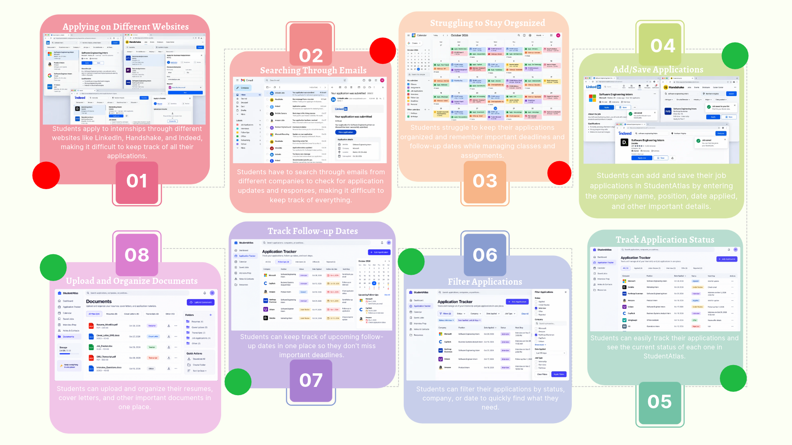

# StudentAtlas — Deliverable 02: Consolidated Application Tracker Storyboard

## Purpose

This consolidated storyboard brings together the team's individual storyboard ideas for the **Application Tracker** feature. It illustrates what students currently do to manage job applications and how they would interact with the proposed StudentAtlas system. This is a **design proposal**, not a demonstration of completed software.

## Consolidated Storyboard

*Figure 1. Team-created consolidated storyboard for the Application Tracker workflow.*

## Before StudentAtlas: Current challenges

1. **Applying on Different Websites:** Students apply for internships using sites such as LinkedIn, Handshake, and Indeed. Their applications are spread across multiple platforms.
2. **Searching Through Emails:** Students check emails from different companies to find application updates and responses.
3. **Struggling to Stay Organized:** Students find it difficult to remember application details, deadlines, and follow-up dates while balancing classes and assignments.

## With StudentAtlas: Proposed interaction flow

4. **Add/Save Applications:** A student opens the Application Tracker, selects the option to add an application, enters the company, position, date applied, and other details, and saves the entry. The new entry appears in the tracker.
5. **Track Application Status:** A student opens an application, reviews its current status, and updates it when a company responds. The tracker displays the updated status.
6. **Filter Applications:** A student chooses a filter such as status, company, or date to narrow the applications shown. The list updates to match the selected criteria.
7. **Track Follow-up Dates:** A student records or reviews follow-up dates and sees upcoming deadlines in the application tracking view.
8. **Upload and Organize Documents:** A student opens the related Document Hub area to upload and organize resumes, cover letters, and other application materials. This is a connected feature that supports the tracker, rather than a core Application Tracker action.

## Relationship to GitHub user stories

- [Issue #2 — Add a Job Application](https://github.com/spattemgmu/StudentAtlas/issues/2): Steps 1 and 4.
- [Issue #3 — Update Application Status](https://github.com/spattemgmu/StudentAtlas/issues/3): Steps 2, 5, and 6.
- [Issue #4 — Keep Track of Deadlines and Interviews](https://github.com/spattemgmu/StudentAtlas/issues/4): Steps 3 and 7.
- **Document Hub:** Step 8 connects the tracker to the proposed document-management functionality.

## Related planning materials

The team's earlier system overview and use case diagram describe StudentAtlas's four planned feature areas: Application Tracker, Document Hub, Job Search Resources, and Career Hub. This storyboard refines the current-sprint workflow by depicting student actions, interface inputs, and expected feedback.

## Implementation status

The screens and interactions in the storyboard represent proposed functionality. Coding and usability testing are not claimed as completed in this deliverable.
