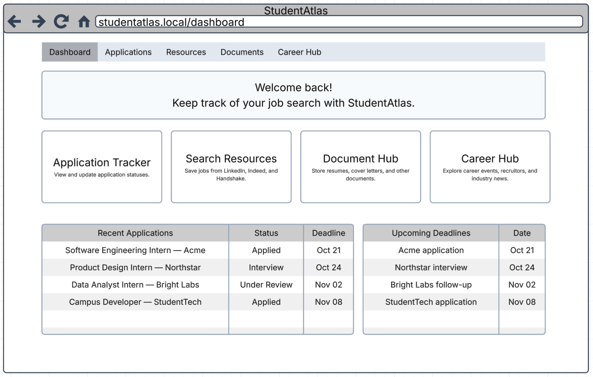

# StudentAtlas — Requirements Research Evidence

> Preliminary team requirements elicitation and product documentation review. This is not a user interview report.

## Purpose and evidence type

This file records preliminary requirements elicitation for StudentAtlas. It combines team-authored user scenarios from Deliverable 1, a proposed interface wireframe, and publicly available product documentation reviewed on October 22, 2026. The scenarios explain anticipated needs; they are not presented as verified interviews or user testing.

## How requirements were identified

Our team brainstormed common difficulties with tracking job and internship applications across multiple sites and drafted five individual before-and-after user stories. The stories discussed spreadsheets, following up, deadlines and interview dates, company career portals, and Handshake. We grouped these scenarios into four planned StudentAtlas features: Application Tracker, Document Hub, Job Search Resources, and Career Hub. Application Tracker was ranked first in our team deliverable.

## Evidence A — Handshake application tracking

Handshake offers a My jobs page that displays applications and lets users review or filter statuses. This is an existing capability, not an absence of tracking. For StudentAtlas, the design opportunity is a student-managed record of applications submitted across several different sources, including applications that may not be captured in one platform. Source: Handshake Help Center, “Job Application Status in Handshake” (updated April 24, 2026).

## Evidence B — Indeed applied and saved jobs

Indeed My Jobs includes Saved, Applied, Interviews, and Archived sections. Its documentation also notes that some features differ for applications made directly on Indeed versus those redirected to employer websites. StudentAtlas could let students manually record opportunities and dates regardless of the website where they applied. Sources: Indeed, “What Is My Jobs?” and “My Jobs: Managing Applied Jobs.”

## Evidence C — LinkedIn job tracker

LinkedIn documents a Job tracker with several stages and notes; for certain external company-site applications, users need to save the job first to track it in LinkedIn. This supports planning a separate user-controlled tracker. It does not mean LinkedIn lacks a tracker. Source: LinkedIn Help, “Track and organize job opportunities.”

## Team user-story evidence (from Deliverable 1)

Shashank described difficulties keeping application records in spreadsheets. Mivel focused on follow-ups; Nandita described checking company websites and email; Sabrina discussed organizing applications through Handshake; Muhammad described deadline and interview-date tracking. These five narratives helped the team prioritize a single Application Tracker. They are member-authored scenarios and should not be described as independently observed usage data.

## Requirements mapped to evidence

Application Tracker: save applications, edit status, log deadlines/interviews and follow-ups; informed by team scenarios and application-tracking documentation. Document Hub: upload and organize resumes and cover letters, then connect them to applications; proposed in the team system overview. Job Search Resources: provide links to external platforms and allow users to save opportunities; informed by use of multiple job sites. Career Hub: curated links to recruiting events and career updates; proposed in the team overview, with further research still needed.

## Limitations and next validation

This review did not establish that StudentAtlas uniquely offers all features or that existing platforms cannot track applications. No formal user interviews, usability recordings, survey dataset, or permission-cleared screenshots of logged-in accounts are documented here. Future validation could involve observing a volunteer navigating job sites, noting where application details are stored, and testing whether a StudentAtlas prototype reduces manual effort. Collect consent and remove personal details before uploading evidence.

## Proposed StudentAtlas dashboard wireframe

Figure 1. Team-created proposed interface from the System Overview in Deliverable 1; this is a concept drawing, not a screenshot of a working application.

## Sources reviewed

- [Handshake Help — Job Application Status in Handshake](https://support.joinhandshake.com/hc/en-us/articles/360004149954-Job-Application-Status-in-Handshake)
- [Indeed Help — What Is My Jobs?](https://www.indeed.com/help/job-seekers/articles/205332490-what-is-my-jobs?co=US&hl=en)
- [Indeed Support — My Jobs: Managing Applied Jobs](https://indeed.zendesk.com/hc/en-us/articles/4412589551757-My-Jobs-Managing-Applied-Jobs)
- [LinkedIn Help — Track and organize job opportunities](https://www.linkedin.com/help/linkedin/answer/a8684146)
